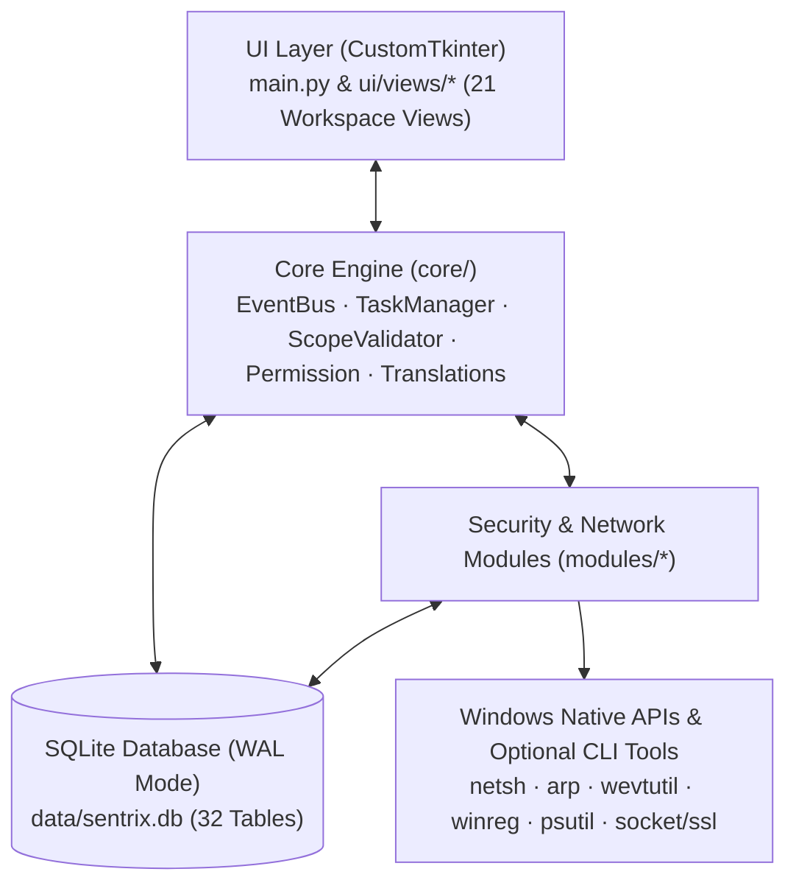

# SENTRIX v5.0 — Modular Windows Security & Network Operations Platform

**SENTRIX** is a modular Windows-native desktop application written in Python for authorized network diagnostics, host/topology discovery, local security auditing, incident correlation, and defensive analysis. Built with `CustomTkinter` and backed by a local SQLite database in Write-Ahead Logging (`WAL`) mode, SENTRIX unifies reconnaissance, telemetry collection, rule-based detection, and a local AI security assistant within a single offline-capable workspace.

---

## Overview

Network administrators and security analysts frequently switch between disconnected command-line utilities (`netsh`, `arp`, `wevtutil`, `netstat`, packet inspectors, and log parsers) during troubleshooting and security assessments. SENTRIX consolidates these workflows into a structured, scope-enforced desktop interface while keeping all telemetry and findings inside a local SQLite database (`data/sentrix.db`).

Key design principles:
- **Scope Enforcement (`core/scope.py`):** Active network scans validate targets against authorized IP ranges, CIDR blocks, and domain allowlists before execution.
- **Local-First & Offline-Capable:** Core telemetry, rule evaluation, and heuristic security analysis run locally without mandatory cloud APIs. Optional local Ollama (`http://localhost:11434`) integration is supported when available.
- **Event-Driven Core (`core/event_bus.py` & `core/task_manager.py`):** Background workers execute network and forensic tasks asynchronously to keep the GUI responsive.

---

## Features & Implemented Modules

All modules listed below are implemented in [`modules/`](./modules) and exposed through dedicated workspace views in [`ui/views/`](./ui/views):

### 1. Network Discovery & Live Topology
- **Live Network Topology Map (`modules/network_topology/`, `ui/views/network_topology_view.py`):** Builds an interactive 2D star-topology canvas centered on the default gateway, classifies discovered endpoints (`[GW]`, `[SRV]`, `[PC]`, `[PRN]`, `[?]`), highlights newly observed MAC/IP pairs, and provides a 4-tab device inspector.
- **Reconnaissance & OSINT (`modules/recon/`, `ui/views/recon_view.py`):** TCP port scanning, banner grabbing, DNS record enumeration (`A`, `AAAA`, `MX`, `TXT`), WHOIS/RDAP lookups, Nmap XML output parsing (`nmap_parser.py`), and scan snapshot diffing (`diff_engine.py`).
- **Wireless & PCAP Analysis (`modules/wireless/`, `modules/packet/`):** Windows `netsh wlan` interface/BSSID inspection and native binary `.pcap` packet header parsing (`pcap_analyzer.py`).

### 2. Defensive Telemetry, Threat Hunting & Detection
- **Attack & Incident Graph (`modules/attack_graph/`, `ui/views/attack_graph_view.py`):** Correlates local process, file, network socket, and persistence telemetry into a 2D causal graph (`User -> Document -> Process -> Network -> Persistence`) with an interactive node inspector.
- **Windows Internals Telemetry (`modules/windows_internals/`, `ui/views/windows_internals_view.py`):** Collects and normalizes live process trees (`psutil`), Windows Registry Run/RunOnce persistence keys (`winreg`), Windows Services, and Event Log / Sysmon records (`wevtutil`).
- **Detection Studio & Correlation (`modules/detection_studio/`, `modules/correlation/`):** Validates and tests YAML-based detection rules (Sigma-style field matching and Suricata rule syntax checks) against normalized local event streams.
- **Threat Hunting Workbench (`modules/threat_hunting/`, `ui/views/threat_hunting_view.py`):** Hypothesis-driven queries across collected host/network entities and timeline reconstruction.

### 3. Local AI Security Assistant (`modules/ai_security/`, `ui/views/ai_copilot_view.py`)
- **Context-Aware Q&A (`assistant_core.py`, `context_builder.py`):** Evaluates natural-language security questions (Turkish & English) against live host telemetry (open ports, active processes, recent alerts) and assigns explicit confidence labels (`Doğrulandı`, `Güçlü belirti`, `İncelenmesi gerekiyor`, `Yetersiz veri`).
- **Hybrid Inference (`local_llm_provider.py`):** Connects to a local Ollama instance if running; automatically falls back to the deterministic local rule engine when offline.
- **Operator Action Guard (`action_guard.py`):** Requires explicit operator confirmation before executing any state-changing remediation command.

### 4. Forensics, Application Security & Specialized Labs
- **Digital Forensics & Artifact Timeline (`modules/forensics/`, `modules/artifact_timeline/`, `modules/memory_forensics/`):** File hashing (`SHA-256` / `MD5`), Shannon entropy calculation, suspicious file quarantine (`data/quarantine/`), Windows Prefetch/Shimcache header parsing, and optional Volatility 3 CLI wrapper (`volatility_adapter.py`).
- **Web & API Security Workbench (`modules/websec/`, `modules/api_sec/`):** HTTP security header auditing (`CSP`, `HSTS`, `X-Frame-Options`), TLS/SSL certificate inspection (`modules/crypto_lab/`), and safe parameter/endpoint checks within authorized scopes.
- **Supply Chain, Cloud & Container Audits (`modules/supply_chain/`, `modules/cloud_security/`, `modules/container_security/`):** Local `requirements.txt` / `package.json` dependency parsing, SBOM generation, and configuration auditors for Docker/Kubernetes/cloud manifests.
- **SOAR Playbooks & Reporting (`modules/soar/`, `modules/reporting/`):** Approval-gated response playbooks with rollback tracking and structured Markdown security report generation.

---

## Architecture



### Directory Structure

```text
SENTRIX/
├── core/                       # Core infrastructure (SQLite WAL DB, EventBus, Scope, TaskManager, i18n)
├── modules/                    # 34 modular domain engines
│   ├── active_directory/       # AD ACL, LDAP & attack path analysis
│   ├── ai_security/            # Local AI Security Copilot, ContextBuilder & ActionGuard
│   ├── artifact_timeline/      # Prefetch, Shimcache & SRUM timeline parsers
│   ├── attack_graph/           # Real-time incident causality graph engine
│   ├── cloud_security/         # AWS, Azure & GCP configuration audit rules
│   ├── container_security/     # Docker, Kubernetes & RBAC manifest auditors
│   ├── correlation/            # Event correlation & Sigma rule evaluation
│   ├── crypto_lab/             # TLS handshake & X.509 certificate inspector
│   ├── detection_studio/       # Rule validation, testing & MITRE coverage mapping
│   ├── forensics/              # File triage, entropy analysis & quarantine manager
│   ├── memory_forensics/       # Process/network memory artifact analysis & Volatility adapter
│   ├── network_topology/       # Live LAN discovery & star-topology visualizer
│   ├── packet/                 # Native binary PCAP parser
│   ├── recon/                  # Port scanner, OSINT, Nmap XML parser & scan diff engine
│   ├── soar/                   # Playbook engine with operator approval & rollback manager
│   ├── supply_chain/           # Dependency scanner, license analyzer & SBOM generator
│   ├── threat_hunting/         # Hypothesis manager, entity graph & query engine
│   ├── websec/                 # HTTP security header & web workbench
│   ├── windows_internals/      # Process, Service, Registry & EventLog collectors
│   └── wireless/               # Windows netsh Wi-Fi scanner & channel analyzer
├── ui/
│   └── views/                  # 21 CustomTkinter workspace views & shared theme components
├── tests/                      # Automated unittest suites (v3, v4, and v5 engines)
├── docs/                       # Versioned architecture, audit, and user guides (v3, v4, v5)
├── data/                       # Runtime SQLite database, audit logs & quarantine directory
├── main.py                     # SENTRIX v5.0 main application entry point
├── main_legacy.py              # Legacy v2 single-file edition preserved for reference
├── SENTRIX.bat                 # Windows GUI launcher (pythonw)
├── SENTRIX_DEBUG.bat           # Windows console debug launcher
└── requirements.txt            # Python package dependencies
```

---

## Technical Requirements

- **Operating System:** Windows 10 / Windows 11 (x64)
- **Python Version:** Python 3.9 – 3.12 (tested on Python 3.11)
- **Direct Python Dependencies (`requirements.txt`):**
  - `customtkinter`
  - `psutil`
  - `requests`
- **Optional External Tools:** SENTRIX runs autonomously using Python's standard library. When present on the system `PATH`, optional integrations can invoke `nmap`, `tshark`, `yara64`, `vol` (Volatility 3), `docker`, or `ollama`.

---

## Installation & Usage

1. **Clone the repository:**
   ```powershell
   git clone https://github.com/mert-carli/SENTRIX.git
   cd SENTRIX
   ```

2. **Create and activate a virtual environment (recommended):**
   ```powershell
   python -m venv venv
   .\venv\Scripts\activate
   ```

3. **Install dependencies:**
   ```powershell
   pip install -r requirements.txt
   ```

4. **Launch SENTRIX:**
   ```powershell
   python main.py
   ```
   *(Alternatively, double-click `SENTRIX.bat` for windowless mode or `SENTRIX_DEBUG.bat` for console output. Running as Administrator is recommended for full Windows Event Log and raw socket access.)*

---

## Testing

SENTRIX includes four automated `unittest` suites covering the core database, scope enforcement, v3/v4 analysis engines, and v5 AI Copilot / Topology / Attack Graph modules:

```powershell
python -m unittest discover -s tests -v
```

Individual test suites:
- `tests/test_core_and_modules.py` — Core SQLite database, Scope validation, and base modules
- `tests/test_v3_engines.py` — Recon diffing, PCAP parsing, Sigma correlation, and forensics
- `tests/test_v4_advanced_engines.py` — Windows internals normalization, Detection Studio, SOAR playbooks, and Supply Chain SBOM
- `tests/test_v5_copilot_and_maps.py` — AI Security Assistant, ActionGuard, Attack Graph, and Network Topology engines

---

## Documentation

Detailed architectural specifications, module matrices, and release notes are organized under [`docs/`](./docs):
- **[v5.0 Release Notes & Architecture](./docs/v5/SENTRIX_V5_RELEASE_NOTES.md)**
- **[v4.0 Architecture](./docs/v4/SENTRIX_V4_ARCHITECTURE.md)** · **[Module Matrix](./docs/v4/SENTRIX_V4_MODULE_MATRIX.md)** · **[Dependencies](./docs/v4/SENTRIX_V4_DEPENDENCIES.md)** · **[Security Review](./docs/v4/SENTRIX_V4_SECURITY_REVIEW.md)** · **[User Guide](./docs/v4/SENTRIX_V4_USER_GUIDE.md)**
- **[v3.0 Architecture & Guides](./docs/v3/)**

---

## Legal Disclaimer & Authorized Use Only

> [!IMPORTANT]
> **Authorized Scope & Lab Use Only:**  
> SENTRIX is developed strictly for defensive security operations, local system administration, educational research, and authorized security assessments. Users must configure and respect target boundaries in the Scope Manager (`core/scope.py`) and obtain explicit written authorization before scanning or testing any network or host they do not own. The author assumes no liability for misuse or unauthorized activity.

---

## License

This project is licensed under the [MIT License](./LICENSE).

## Author

**Mevlana Mert Çarlı**  
- GitHub: [@mert-carli](https://github.com/mert-carli)  
- Portfolio: [mert-carli-cvu9.vercel.app](https://mert-carli-cvu9.vercel.app)
